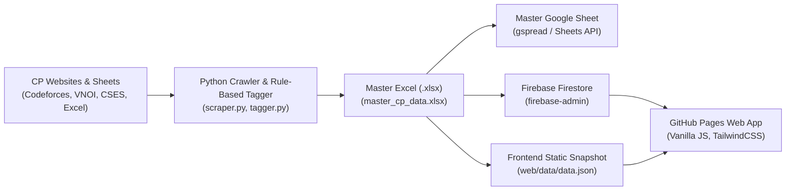

# 🚀 Automated Competitive Programming (CP) LMS & Portfolio

An automated, token-free Competitive Programming Learning Management System and Portfolio website. Built to crawl, categorize, organize, and synchronize 700+ competitive programming problems, tutorials, and VOI/ICPC algorithm roadmaps without relying on expensive LLM API calls.

---

## 🏗️ Architecture & Workflow



1. **Crawler & Ingestion**: Reads problem links, ratings, and notes from Excel files, Google Sheets, or web platforms.
2. **Rule-Based Tagger**: Categorizes exercises into Graph Theory, DP, Data Structures, Trees, Math, Geometry, Strings, etc., using regex and heuristic matching.
3. **Master Excel Export**: Consolidates cleaned data into `master_cp_data.xlsx` via `pandas`.
4. **Cloud Sync**: Simultaneously pushes data to a Master Google Sheet and Firebase Firestore collections (`exercises`, `materials`, `roadmap`, `projects`).
5. **Modern Frontend**: Fast, responsive single-page web app hosted on GitHub Pages with dual data engine (Live Firestore + Static JSON fallback).
6. **Automation**: GitHub Actions workflow (`.github/workflows/main.yml`) runs weekly or on push.

---

## 📂 Project Structure

```text
D:\0.CP\Webcanhan\
├── .github/
│   └── workflows/
│       └── main.yml               # Automated pipeline & GitHub Pages deployment
├── config/
│   ├── config.py                  # Paths, environment config, credential loader
│   └── service_account.json.example # Template for Firebase & Google Cloud credentials
├── scripts/
│   ├── __init__.py
│   ├── tagger.py                  # Rule-based tagging & classification engine
│   ├── scraper.py                 # Multi-source CP data crawler & parser
│   ├── export_master.py           # Generates master_cp_data.xlsx & web/data/data.json
│   └── sync_firebase.py           # Syncs to Google Sheets & Firebase Firestore
├── web/                           # GitHub Pages frontend
│   ├── index.html                 # Modern SPA dashboard (TailwindCSS, responsive)
│   ├── app.js                     # Frontend logic: live Firestore sync, local fallback, search, filter
│   ├── styles.css                 # Glassmorphism dark-theme aesthetics & badges
│   ├── firebase-config.js         # Firebase client config template
│   └── data/
│       └── data.json              # Bundled offline data snapshot
├── master_cp_data.xlsx            # Generated Master CP Workbook (Pandas)
├── run_pipeline.py                # Unified CLI runner (crawl, export, sync)
├── requirements.txt               # Pinned Python dependencies
└── README.md                      # Documentation & setup guide
```

---

## ⚡ Quick Start

### 1. Install Dependencies
```bash
pip install -r requirements.txt
```

### 2. Run the Pipeline Locally
```bash
# Run full pipeline with validation dry-run
python run_pipeline.py --all --dry-run

# Run full pipeline with live export
python run_pipeline.py --all
```

### 3. Launch Frontend Locally
```bash
python -m http.server -d web 8080
```
Open `http://localhost:8080` in your browser. The app runs immediately using `web/data/data.json`.

---

## 🔐 Credentials & Cloud Setup

### 1. Firebase Firestore Setup
1. Create a Firebase project at [Firebase Console](https://console.firebase.google.com/).
2. Navigate to **Firestore Database** -> Click **Create Database** (Start in production mode or test mode).
3. Under **Project Settings** -> **Service accounts**, click **Generate new private key**.
4. Download the `.json` file and save it as `config/service_account.json` (do not commit this file to public git).

### 2. Google Sheets API Setup
1. In [Google Cloud Console](https://console.cloud.google.com/), enable the **Google Sheets API** and **Google Drive API**.
2. Create a service account or reuse the Firebase service account.
3. Create a Google Sheet and copy its Spreadsheet ID from the URL:
   `https://docs.google.com/spreadsheets/d/<SPREADSHEET_ID>/edit`
4. Click **Share** on your Google Sheet and invite your service account email (e.g., `xxx@your-project.iam.gserviceaccount.com`) as **Editor**.

### 3. Configure GitHub Secrets (for GitHub Actions)
In your GitHub repository, go to **Settings** -> **Secrets and variables** -> **Actions** -> **New repository secret**:

| Secret Name | Description |
| :--- | :--- |
| `FIREBASE_SERVICE_ACCOUNT` | Entire contents of your `service_account.json` |
| `GOOGLE_SHEETS_CREDENTIALS` | Same JSON as above (or dedicated Sheets credentials JSON) |
| `GOOGLE_SPREADSHEET_ID` | Your Google Spreadsheet ID |

### 4. Enable GitHub Pages
1. Go to repository **Settings** -> **Pages**.
2. Under **Build and deployment** -> **Source**, select **GitHub Actions**.
3. Push to `main` or trigger the workflow manually from the **Actions** tab.

---

## 🏷️ Rule-Based Tagging System

The tagger (`scripts/tagger.py`) operates purely with deterministic rules and regex patterns:
- **Zero Token Cost**: No expensive LLM API calls required.
- **Categorization**: Auto-maps topics into *Graph Theory, Trees, Dynamic Programming, Data Structures, Mathematics, Geometry & Sweepline, Strings, Greedy & Search, Game Theory & Adhoc*.
- **Platform Recognition**: Parses URLs from Codeforces, VNOI, CSES, LQDOJ, OJ.UZ, AtCoder, DMOJ, MarisaOJ, USACO, and more.
- **Rating Normalization**: Converts difficulty scores (e.g. 2400) into standardized tiers (*Easy, Medium, Hard, Master/VOI, Grandmaster/TST*).
